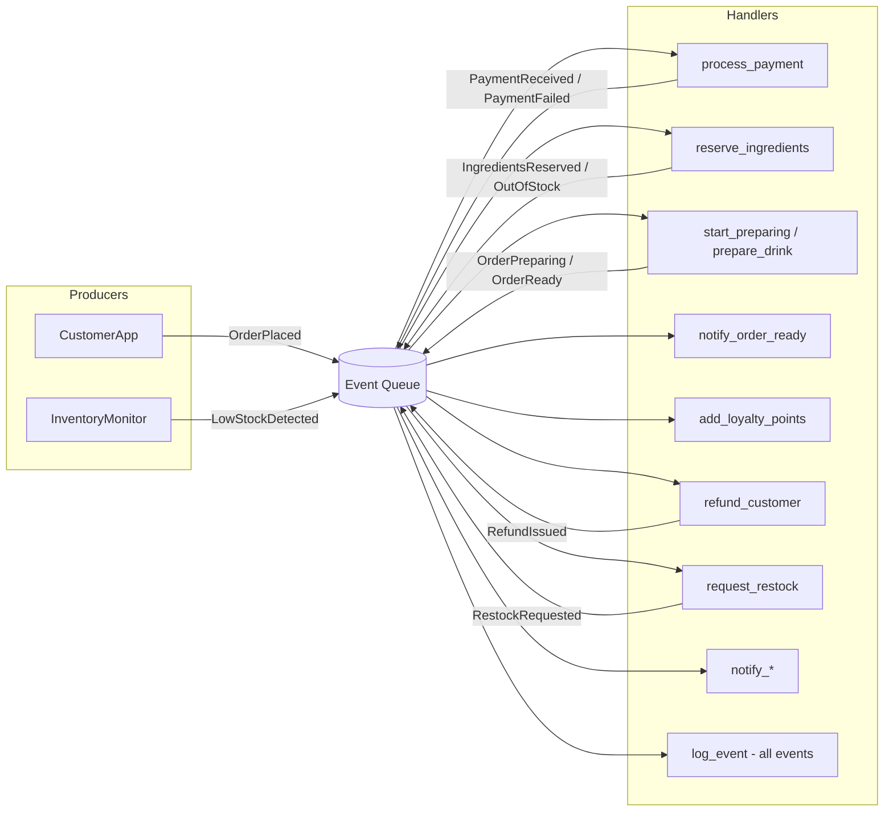
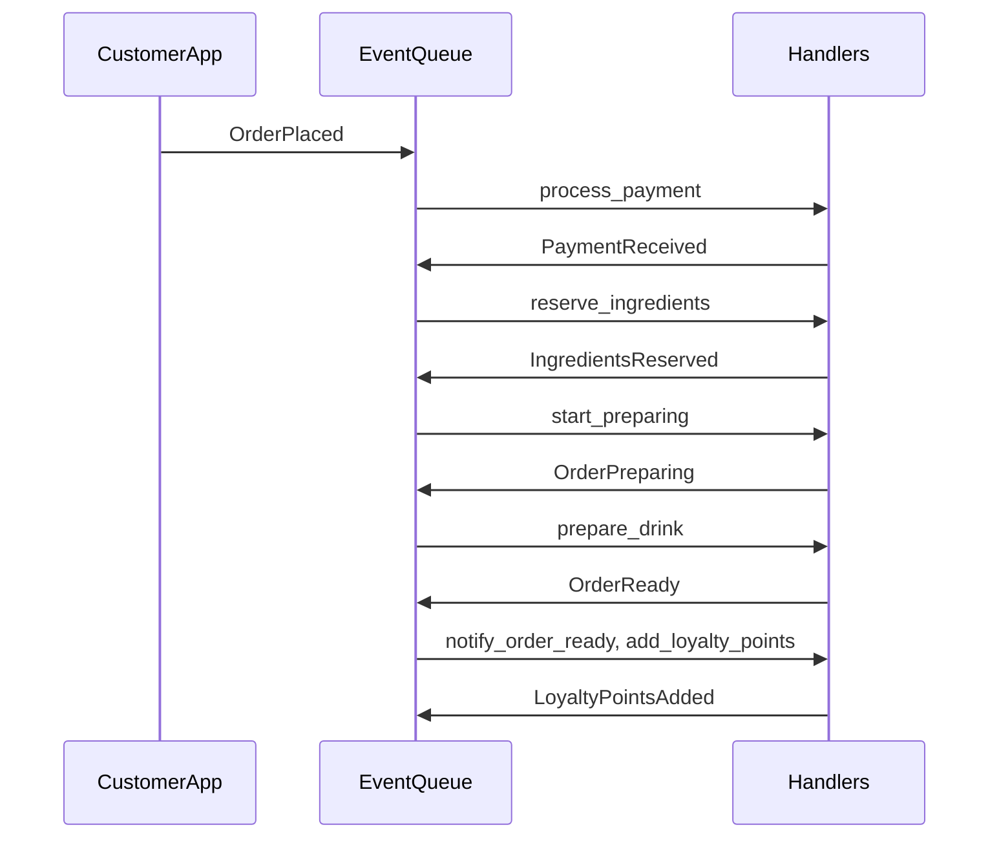

# Architecture

The app uses **Event-Driven Architecture**. Components do not call each other directly.
Producers put events in a queue, and handlers subscribed to those events react to them.
A handler can publish new events, which creates a chain of reactions.

## Components

### 1. Event producers (`edp/producers.py`)
They only create events and put them in the queue.
- **CustomerApp** - emits `OrderPlaced`
- **InventoryMonitor** - periodically checks stock, emits `LowStockDetected`

### 2. Event queue (`edp/event_queue.py`)
Local FIFO queue (`collections.deque`) + a dictionary `event type -> list of handlers`.
- `subscribe(type, handler)` - register a handler
- `publish(type, payload)` - add an event to the queue
- `run()` - take events one by one and call all subscribed handlers, until the queue is empty

### 3. Event handlers (`edp/handlers.py`)
Functions that react to events: payment, inventory, barista, notifications,
loyalty, refunds, logging. Some of them publish follow-up events.

## Diagram

## Event flow (successful order)

## Failure branches
- `OrderPlaced` -> `PaymentFailed` -> customer notification (end)
- `PaymentReceived` -> `OutOfStock` -> `RefundIssued` -> customer notification
- stock below threshold -> `LowStockDetected` -> `RestockRequested`

## Why this design
- **Loose coupling**: the payment code does not know about the barista or notifications.
- **Easy to extend**: a new feature = a new handler with one `subscribe` line.
- **Easy to test**: publish an event and check which events appear next.
